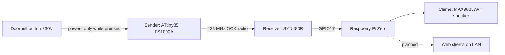

# Doorbell

A wireless add-on for an existing 230 V doorbell. When someone presses the
button, a small radio sender inside the apartment transmits a signal. A
Raspberry Pi in the local network receives it and rings a chime. The planned
next step is to push the event to web clients on the LAN.

The goal is the simplest and cheapest design that uses common parts available
in Poland. The sender needs no batteries and no rewiring of the button.

## How it works

The dashed arrow is not built yet.

## Repository layout

| Path | Content |
| --- | --- |
| `sender/doorbell_sender.ino` | Arduino firmware for the ATtiny85 |
| `receiver/listen.py` | Decoder, chime playback, terminal display |
| `receiver/*.wav` | Chime sounds that `listen.py` plays |
| `receiver/deploy/` | Scripts that copy the receiver to the Pi and install the service |
| `receiver/sound_tools/` | Scripts that generate and amplify the sounds |
| `receiver/rx_probe.py`, `test_dac.sh` | Hardware debug tools for the radio and the DAC |
| `spec/` | Design documents |

## Specs

1. [`spec/001_initial/spec.md`](spec/001_initial/spec.md): the original
   requirements.
2. [`spec/001_initial/plan.md`](spec/001_initial/plan.md): the first design
   plan, with wiring, parts list, and programming steps. Some assumptions
   changed during the build.
3. [`spec/002_build.md`](spec/002_build.md): what was built, the final
   design, and the lessons learned. This file takes priority over the plan.

Start with `spec/002_build.md` for the current design.
