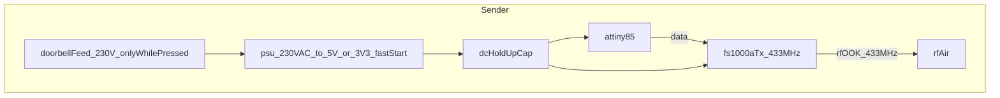
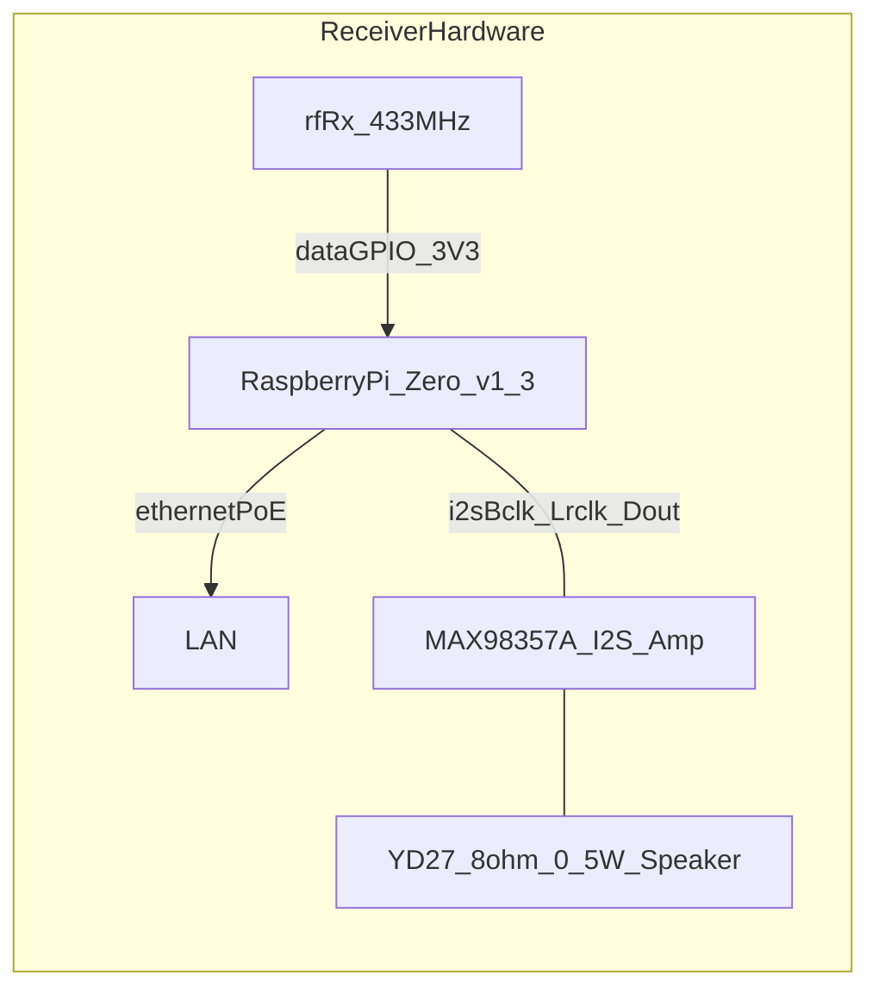
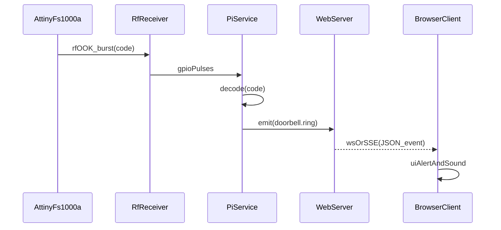

# Doorbell RF-to-LAN design plan (existing installation, sender inside apartment, no batteries)

## Goals and constraints

- **Keep the existing 230V doorbell installation**: add a sender module inside the apartment without rewiring the button to low voltage.
- **Simplest possible 2-part system**: sender (normally off, triggered by existing 230V doorbell circuit) + receiver (always-on mini-computer on 5V).
- **No batteries**: sender should be powered from the doorbell wiring.
- **Local-network only notifications**: clients are connected to the same LAN; “push” means real-time updates to open web clients (not APNs/FCM).
- **Safety first with 230V**: any mains handling must use certified modules/enclosures and appropriate protection.

## Architecture (high level)

- **Sender**: is powered only while the doorbell button is pressed (switched live). On power-up, it transmits a short RF burst with a fixed ID.
- **Receiver**: Raspberry Pi + 433 MHz RF receiver module decodes the ID and triggers a software event.
- **Server**: small web server on the Pi keeps a list of connected clients and emits “doorbell” events over WebSocket/SSE.


## Sender design

### Idea

- Indoors, **L–N is 0V when idle** and **~230V only while pressed**, so the sender is powered only during the press.
- The sender is a **power-on event transmitter**: when the doorbell is pressed, the PSU output comes up, the MCU boots, and it transmits immediately.
- An **ATtiny85-20PU** firmware transmits a short, repeated **OOK** burst on **433 MHz** using an **FS1000A** module.

### Sender power

- Use a **small, certified 230V→5V (or 3.3V) PSU module** connected to the indoor doorbell feed.
  - The PSU must have **fast startup** so a short press still results in a transmission.
  - Add **DC hold-up capacitance** so the sender stays alive long enough to transmit a complete burst even with short taps.
  - Firmware must **transmit immediately on power-up** (no waiting for clocks, network, etc.).

### RF protocol choice

- Transmit a fixed “doorbell code” with a simple OOK scheme that is easy to decode on the Pi.
  - Keep the payload small (an ID + optional sequence).
  - Repeat the burst multiple times per ring to survive packet loss/interference.
  - Design so that a single press yields enough repeats even with short presses and RF interference.

### Sender BOM

- **MCU**: ATtiny85-20PU (DIP-8, ISP).
- **433 MHz transmitter**: FS1000A 433 MHz OOK module.
- **PSU**: certified 230V→5V or 3.3V module (fast-start preferred).
- **Hold-up**: bulk capacitor(s) on the DC output sized for a full transmit burst.
- **Programming header**: 2×3 ISP header (or pads) for **MISO / MOSI / SCK / RESET / VCC / GND**.
- **Enclosure + protection**: insulated enclosure, strain relief, appropriate terminals; fuse where appropriate for the added branch.

### Sender wiring (detailed, with capacitors)

Power (DC side):
- PSU DC+ → `VCC_5V` net
- PSU DC- → `GND` net
- **Hold-up capacitor**: `C_HOLDUP` electrolytic **470 µF–2200 µF** between `VCC_5V` and `GND` near the PSU output (observe polarity).
- **Local bulk**: `C_BULK` **10 µF** between `VCC_5V` and `GND` near the MCU/RF section.
- **Decoupling**:
  - `C_MCU` **100 nF** between ATtiny85 **VCC (pin 8)** and **GND (pin 4)**, placed as close as possible to the pins.
  - `C_TX` **100 nF** between FS1000A **VCC** and **GND**, placed as close as possible to the module pins.

ATtiny85-20PU pinout (for reference):
- Pin 1: RESET (ISP)
- Pin 2: PB3
- Pin 3: PB4
- Pin 4: GND
- Pin 5: PB0 (MOSI, ISP)
- Pin 6: PB1 (MISO, ISP)
- Pin 7: PB2 (SCK, ISP)
- Pin 8: VCC

Signal wiring:
- Use a non-ISP pin for RF data so programming stays uncomplicated:
  - ATtiny85 **PB3 (pin 2)** → (`R_SER` optional **220 Ω–1 kΩ**) → FS1000A **DATA**
- FS1000A **VCC** → `VCC_5V`
- FS1000A **GND** → `GND`
- FS1000A **ANT** → ~**17.3 cm** wire antenna (keep away from mains wiring)

Notes:
- Prefer **5V** for FS1000A + ATtiny85 if available from the PSU (better RF output margin than 3.3V with many FS1000A modules).
- Keep the RF section (FS1000A + antenna) physically separated from the PSU/mains wiring inside the enclosure.

ASCII diagram (sender, DC side + RF):

```
  doorbellFeed_230V_onlyWhilePressed
          |
          v
   +-------------------+
   |   PSU 230VAC->5V  |
   | (fast-start)      |
   +----+---------+----+
        |         |
      VCC_5V     GND
        |         |
        |   +-----+---------------------------------+
        |   |                                       |
        |  === C_HOLDUP 470u-2200u                  |
        |   |                                       |
        +---+-------------------+-------------------+-----> to loads
            |                   |                   |
           === C_BULK 10u      === C_MCU 100n      === C_TX 100n
            |                   |                   |
           GND                 GND                 GND

                 ATtiny85-20PU (DIP-8)                 FS1000A
               +-----------------------+             +-----------------+
   VCC_5V ---- | 8 VCC           PB3 2 | --[R_SER]-- | DATA            |
     GND  ---- | 4 GND               7 |             | VCC ---- VCC_5V |
               | 1 RESET (ISP)         |             | GND ---- GND    |
               | 5 MOSI  6 MISO  7 SCK |             | ANT -> ~17.3cm  |
               +-----------------------+             +-----------------+
```


### Programming the ATtiny85-20PU (macOS, using Arduino as ISP)

- The ATtiny85 is typically programmed over **ISP** (SPI + RESET).

Hardware:
- **Arduino Uno / Nano** (programmer)
- **ATtiny85-20PU**
- Breadboard + jumper wires
- **0.1 µF capacitor** between Arduino **RESET ↔ GND** (to prevent auto-reset during programming)

ISP header/pads on the sender board (recommended pinout):
- 2×3 header pins (standard AVR ISP numbering):
  - **1: MISO**
  - **2: VCC**
  - **3: SCK**
  - **4: MOSI**
  - **5: RESET**
  - **6: GND**

ASCII diagram (ISP header on the sender board):

```
  AVR ISP 2x3 header (top view)
  +---+---+
  | 1 | 2 |   1=MISO   2=VCC
  +---+---+
  | 3 | 4 |   3=SCK    4=MOSI
  +---+---+
  | 5 | 6 |   5=RESET  6=GND
  +---+---+
```

Wiring (Arduino → ATtiny85):
- **Arduino 5V** → ATtiny85 **VCC** (pin 8)
- **Arduino GND** → ATtiny85 **GND** (pin 4)
- **Arduino D10** → ATtiny85 **RESET** (pin 1)
- **Arduino D11 (MOSI)** → ATtiny85 **PB0/MOSI** (pin 5)
- **Arduino D12 (MISO)** → ATtiny85 **PB1/MISO** (pin 6)
- **Arduino D13 (SCK)** → ATtiny85 **PB2/SCK** (pin 7)

Tooling on macOS:
- Arduino IDE
- Install an ATtiny core (e.g. **ATTinyCore** by Spence Konde) via Boards Manager.

Workflow:
- Upload the **ArduinoISP** sketch to the Arduino.
- Select ATtiny85 in Arduino IDE, set the desired clock (start with **8 MHz internal**), pick **Programmer: Arduino as ISP**.
- Run **Burn Bootloader** (sets fuses/clock).
- Upload firmware via **Upload Using Programmer**.

Programming checklist:
- Keep an ISP header/pads accessible (at least on early iterations).
- Ensure your firmware clock/fuse settings match the code timing (OOK pulse generation depends on it).

ASCII diagram (Arduino as ISP -> ATtiny85):

```
  Arduino UNO/Nano           ATtiny85-20PU (DIP-8)
  ----------------           ---------------------
  5V          ------------------>    8 VCC
  GND         ------------------>    4 GND
  D10         ------------------>    1 RESET
  D11(MOSI)   ------------------>    5 PB0/MOSI
  D12(MISO)   ------------------>    6 PB1/MISO
  D13(SCK)    ------------------>    7 PB2/SCK

  Add: 0.1uF capacitor between Arduino RESET and GND
```

## Buying list

### Sender (inside apartment)
- [**ATtiny85-20PU**](https://botland.com.pl/avr-w-obudowie-tht/2795-mikrokontroler-avr-attiny85-20pu-5904422331177.html) (DIP-8)
- [**FS1000A 433 MHz transmitter**](https://botland.com.pl/moduly-radiowe/3191-modul-radiowy-nadajnik-fs1000a-odbiornik-433-mhz-5904422331573.html)
- [**Fast-start, certified 230V→5V PSU module**](https://botland.com.pl/zasilacze-montazowe/10929-zasilacz-hi-link-hlk-pm01-100v-240vac-5vdc-06a-5904422317102.html) - enclosed or PCB module rated for mains use
- **Hold-up capacitance** (pick one approach):
  - [470 µF–2200 µF electrolytic](https://botland.com.pl/kondensatory-elektrolityczne-tht/135-kondensator-elektrolityczny-1000uf25v-10x17mm-105c-tht-5szt-5903351248211.html) (low ESR preferred)
  - [100 nF ceramic](https://botland.com.pl/kondensatory-ceramiczne-tht/210-kondensator-ceramiczny-100nf50v-tht-10szt-5903351248198.html) close to MCU and close to FS1000A
- **Passives / small parts**:
  - [100 nF decoupling capacitors](https://botland.com.pl/kondensatory-ceramiczne-tht/210-kondensator-ceramiczny-100nf50v-tht-10szt-5903351248198.html) (at least 2–3)
  - [Status LED + resistor](https://botland.com.pl/diody-led/4663-zestaw-diod-led-5mm-10szt-z-rezystorami-5904422309718.html):
    - LED: any standard **3mm/5mm** indicator LED (color of choice)
    - Resistor (assuming **5V** VCC): **1 kΩ**, **≥0.125W** (gives ~2–3 mA for most LEDs)
    - If you want it brighter: **330–680 Ω** (still typically safe, but higher current)
- **Terminations & enclosure**:
  - Insulated enclosure suitable for mains wiring
  - WAGO/lever terminals, strain relief, appropriately rated wire
  - 2×3 ISP header (or test pads) for MISO/MOSI/SCK/RESET/VCC/GND

### Receiver (inside apartment)
- [**Raspberry Pi Zero v1.3**](https://botland.com.pl/moduly-i-zestawy-raspberry-pi-zero/9750-raspberry-pi-zero-v13-512mb-ram-ze-zlaczami-5904422376345.html)
- [**microSD 16 GB**](https://botland.com.pl/karty-pamieci-microsd-sd/2123-karta-pamieci-goodram-m1aa-microsd-16gb-100mbs-uhs-i-klasa-10-z-adapterem-5908267930137.html)
- [**Waveshare PoE Ethernet HAT**](https://botland.com.pl/huby-usb-do-raspberry-pi/21726-hub-3x-usb-z-gniazdem-ethernet-poe-z-obudowa-do-raspberry-pi-zero-waveshare-20895.html) - for Ethernet + PoE power; requires access to the 40-pin header
- Ethernet patch cable (to PoE router/switch; or PoE injector)
- [**433 MHz receiver module**](https://botland.com.pl/moduly-radiowe/3191-modul-radiowy-nadajnik-fs1000a-odbiornik-433-mhz-5904422331573.html) - prefer superheterodyne; ensure DATA is 3.3V-safe for Pi GPIO
- [**MAX98357A I2S DAC**](https://botland.com.pl/odtwarzacze-mp3-wav-ogg-midi/13062-max98357a-dekoder-stereo-dac-i2s-sparkfun-dev-14809-5903351249676.html) - for local chime playback
- [**YD27 Speaker**](https://botland.com.pl/glosniki-analogowe/3471-glosnik-yd27-05w-8ohm-27x5mm-5903351245876.html)
- Antenna wire (~17.3 cm)
- Jumper wires / header if needed

### Programming (for ATtiny85 on macOS)
- [**Arduino Uno**](https://botland.com.pl/arduino-seria-podstawowa-oryginalne-plytki/1060-arduino-uno-rev3-a000066-7630049200050.html) (as ISP)
- [**USB-A -> USB-B cable**](https://botland.com.pl/przewody-usb-a-b/20523-przewod-usb-a-b-20-lanberg-z-filtrem-ferrytowym-czarny-1m-5901969428643.html) - to connect Arduino to MacBook
- Breadboard + jumper wires
- [**100 nF capacitor**](https://botland.com.pl/kondensatory-ceramiczne-tht/210-kondensator-ceramiczny-100nf50v-tht-10szt-5903351248198.html) - Arduino RESET↔GND

### Extra parts

To get free delivery and experiment with Arduino more.

 - [USB-A -> USB-C cable 1,8 m](https://botland.com.pl/przewody-usb-c/14828-przewod-lanberg-usb-a-31-usb-c-czarny-18m-5901969416190.html)
 - [Ground humidity sensor](https://botland.com.pl/czujniki-wilgotnosci/1588-czujnik-wilgotnosci-gleby-5904422368289.html)
 - [Fluid-level sensor](https://botland.com.pl/czujniki-poziomu-cieczy/4503-czujnik-poziomu-cieczy-analogowy-przewody-waveshare-9525-5904422366612.html)
 - [Color sensor](https://botland.com.pl/czujniki-swiatla-i-koloru/14429-czujnik-koloru-tcs34725-i2c-waveshare-16131-5904422366742.html)
 - [Light-intensity sensor](https://botland.com.pl/czujniki-swiatla-i-koloru/17481-cyfrowy-czujnik-natezenia-swiatla-tsl25911-i2c-waveshare-17146-5904422327644.html)
 - [Temperature and humidity sensor](https://botland.com.pl/czujniki-multifunkcyjne/4920-czujnik-temperatury-i-wilgotnosci-dht22-am2302-modul-przewody-waveshare-11092-5904422366889.html)


## Receiver design (hardware)

- **Mini-computer**: Raspberry Pi Zero v1.3 + Ethernet via **Waveshare PoE Ethernet HAT** (powered from PoE).
- **RF receiver**: 433 MHz superheterodyne module (typically labeled RXB6 / SYN470R / XY-MK-5V variants).
- **Wiring**:
  - RF receiver VCC: choose a module that supports **3.3V** output or add a simple level shifter/voltage divider if it outputs 5V logic.
  - RF receiver DATA → Pi GPIO input.
  - RF receiver GND → Pi GND.
  - Antenna: simple ~17.3 cm wire for 433 MHz quarter-wave.

### Receiver wiring (detailed, with capacitors)

Recommended approach: power the RF receiver from **3.3V** so its DATA level is 3.3V-safe for the Pi.

Example wiring (Raspberry Pi 40-pin header):
- Pi **3V3** (physical pin **1**) → RF receiver **VCC**
- Pi **GND** (physical pin **6**) → RF receiver **GND**
- Pi **GPIO17** (physical pin **11**) → RF receiver **DATA**

Decoupling at the RF receiver module:
- `C_RX` **100 nF** between RF receiver **VCC** and **GND**, placed close to the module.
- `C_RX_BULK` **10 µF** between RF receiver **VCC** and **GND**, placed close to the module.

If your receiver module requires 5V VCC:
- Power it from Pi **5V** (physical pin **2** or **4**), but do **not** feed 5V DATA into the Pi.
- Add a simple divider or level shifter on DATA before the GPIO input (so the GPIO sees ≤3.3V).

ASCII diagram (receiver):

```
  Raspberry Pi Zero v1.3 (40-pin)              433 MHz RX module
  -------------------------------              -----------------
  Pin 1  (3V3)           ---------------------------> VCC
  Pin 6  (GND)           ---------------------------> GND
  Pin 11 (GPIO17)        ---------------------------> DATA

  Place near RX module:
    C_RX     100nF between VCC and GND
    C_RX_BULK 10uF  between VCC and GND

  ANT on RX -> ~17.3cm wire

  Network/power:
    Ethernet + PoE via Waveshare PoE Ethernet HAT -> powers the Pi and provides LAN connectivity
```

### Local chime (I2S amp + speaker)

Parts:
- **MAX98357A** I2S DAC/amp module
- **YD27 0.5W 8Ω** speaker

Wiring (I2S, typical MAX98357A pin names):
- Pi **5V** (physical pin **2** or **4**) → MAX98357A **VIN**
- Pi **GND** → MAX98357A **GND**
- Pi **GPIO18** (physical pin **12**, I2S BCLK) → MAX98357A **BCLK**
- Pi **GPIO19** (physical pin **35**, I2S LRCLK/WS) → MAX98357A **LRC**
- Pi **GPIO21** (physical pin **40**, I2S DOUT) → MAX98357A **DIN**
- MAX98357A **SPK+ / SPK-** → speaker terminals

Decoupling at the amp module:
- `C_AMP` **100 nF** between **VIN** and **GND**, close to the module
- `C_AMP_BULK` **10 µF** between **VIN** and **GND**, close to the module

ASCII diagram (local chime):

```
  Raspberry Pi Zero v1.3 (40-pin)             MAX98357A                 Speaker
  -------------------------------             ---------                 -------
  Pin 2/4 (5V) ----------------------------> VIN
  Pin 6   (GND)----------------------------> GND
  Pin 12 (GPIO18 / BCLK) ------------------> BCLK
  Pin 35 (GPIO19 / LRCLK) -----------------> LRC
  Pin 40 (GPIO21 / DOUT) ------------------> DIN

  Place near MAX98357A:
    C_AMP      100nF between VIN and GND
    C_AMP_BULK  10uF between VIN and GND

  MAX98357A SPK+ ---------------------------> +
  MAX98357A SPK- ---------------------------> -
```



## Receiver software design

### Components

- **RF listener service**
  - Reads GPIO changes and decodes OOK codes for the chosen FS1000A/ATtiny protocol.
  - Emits a normalized event: `doorbell.ring` with metadata (timestamp, code, RSSI if available).

- **Web server (single-process is fine)**
  - Serves a minimal web UI.
  - Maintains client connections via **WebSocket** (preferred) or **SSE** (simpler) for real-time.
  - When RF event arrives, pushes an event to all connected clients.

- **Local chime output**
  - When `doorbell.ring` is received, play a local sound file on the Pi (via ALSA/I2S) through MAX98357A + speaker.
  - Simple implementation: shell out to `aplay` for a WAV file.

- **Browser client**
  - Connects to `/events` (SSE) or WS endpoint.
  - On ring: shows a banner and plays a sound.

### Protocol and payload

- **RF layer**: OOK at 433 MHz, fixed code (24-bit typical) repeated.
- **LAN layer**: JSON message.

Example message:

- `{"type":"doorbell.ring","ts":"2026-01-03T12:34:56Z","code":1234567}`



## Security and reliability considerations (minimal but important)

- **RF spoofing**: OOK remotes are trivially replayable; for a doorbell this is usually acceptable.
- **Debounce/rate-limit**: treat multiple repeats within a short window as one “ring”.
- **Autostart**: run services under systemd so they survive reboots.

## Deliverables to produce (documentation + diagrams)

- A single spec doc (e.g. [`spec/002_design.md`](/Users/eryk.napierala/Development/doorbell/spec/002_design.md)) containing:
  - Final sender wiring (existing 230V sensing + 433 MHz transmitter) with a **clear wiring diagram**.
  - Final receiver GPIO pin choice and wiring.
  - Chosen software stack and run instructions.
  - Mermaid diagrams (high level, sender, receiver, server-client).
  - Shopping list with Poland sources (Botland/TME/Allegro search terms).

## Implementation steps (what we’ll do in order)

- Confirm sender trigger integration point (inside apartment, at the bell/chime feed) and verify the doorbell circuit is 230V.
- Verify with a meter that **L–N is ~0V idle and ~230V on press**, and confirm PE is not part of the switching loop.
- Assemble the sender hardware (doorbell-feed PSU + hold-up + ATtiny85 + FS1000A) with an accessible ISP header/pads.
- Program the ATtiny85 from macOS (Arduino as ISP) and verify it transmits immediately on power-up.
- Capture and validate the transmitted code using the Pi + receiver.
- Implement RF listener + web server + simple client.
- Add systemd units and minimal config (GPIO pin, allowed code, debounce window).

## Mermaid diagrams to include in the final design doc

- High-level flowchart (sender→receiver→LAN clients)
- Sender wiring (button→isolation→RF transmit)
- Receiver wiring (RF RX→GPIO→LAN)
- Sequence diagram for end-to-end ring event