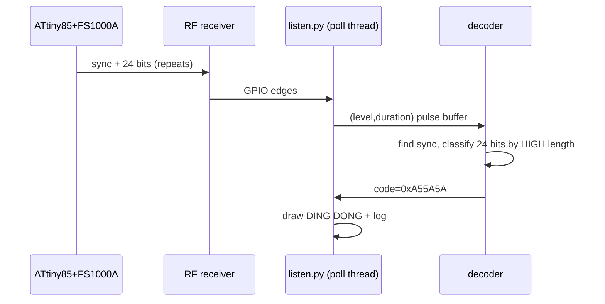

# Doorbell RF-to-LAN — build notes, final design & lessons learned

This documents what we actually built and got working: a 433 MHz OOK doorbell
sender (ATtiny85 + FS1000A) and a Raspberry Pi receiver that decodes the code
and displays it. It supersedes the planning assumptions in
[`001_initial/plan.md`](001_initial/plan.md) where reality differed.

## What we built

- **Sender**: ATtiny85-20PU running a PT2262-style OOK transmitter driving an
  FS1000A 433 MHz module. Powered from the doorbell circuit (button press),
  it boots and transmits a fixed 24-bit code (`0xA55A5A`) continuously. A
  hold-up capacitor keeps it alive after a short tap; Brown-Out Detection
  guarantees a clean reset for the next press.
- **Receiver**: Raspberry Pi Zero + 433 MHz receiver module on GPIO17. A Python
  service (`receiver/listen.py`) polls the pin in a tight background thread,
  decodes the OOK frames, and shows an ASCII animation (idle → DING DONG →
  released) plus a rolling log.

Firmware: [`sender/doorbell_sender.ino`](../sender/doorbell_sender.ino)
Receiver: [`receiver/listen.py`](../receiver/listen.py)

## High-level architecture


## RF protocol (as implemented)

PT2262-compatible OOK at 433 MHz, base pulse ~350 µs:

- **Sync**: HIGH `SHORT` (350 µs) + LOW `SYNC` (10500 µs, = 30× short)
- **Bit 1**: HIGH `LONG` (1050 µs) + LOW `SHORT` (350 µs)
- **Bit 0**: HIGH `SHORT` (350 µs) + LOW `LONG` (1050 µs)
- 24 data bits per frame, MSB first, code = `0xA55A5A`
- Frames repeat continuously with a ~20 ms gap while powered



## Key lessons learned (the debugging story)

These are the non-obvious things that cost us time. Recorded so the next
iteration (and the receiver web-server work) doesn't repeat them.

### 1. Toolchain: ATTinyCore download server can be down
`ATTinyCore:1.5.0` failed to install (its micronucleus tool host refused the
connection). Fix: install an **older ATTinyCore version** (1.4.1 worked). Also
note **megaTinyCore does NOT support the ATtiny85** — it's for the newer
tinyAVR-1/2 series only.

### 2. Programming the ATtiny85 with Arduino-as-ISP
- Board: **ATtiny25/45/85 (No bootloader)**, Chip **ATtiny85**, Clock **8 MHz
  internal**, Programmer **Arduino as ISP (ATTinyCore)**.
- The **100 nF cap between the Uno's RESET and GND** disables the Uno's
  auto-reset so it stays running as a programmer. (Auto-reset is normally a
  *feature* for uploading to the Uno; it's a nuisance in ISP mode.)
- `expected signature for ATmega328P` = avrdude is talking to the Uno, not the
  target — wrong Board selected or ISP wiring off by a row.
- The red "error" LED on the ArduinoISP after a *successful* verify is a
  harmless ATTinyCore 1.4.1 quirk — trust `avrdude done. Thank you.`

### 3. Raspberry Pi OS GPIO stack
- `pip` is externally-managed on current Pi OS → use
  `pip3 install <pkg> --break-system-packages` (fine on a single-purpose Pi).
- `RPi.GPIO`'s `add_event_detect` fails on recent Pi OS
  (`Failed to add edge detection`). The drop-in replacement is **rpi-lgpio**.
  But `rpi_rf` pulls in its own `RPi.GPIO` that shadows it — we ended up not
  using `rpi_rf` at all.

### 4. Don't slow the timing to fix a software problem (the big one)
The Pi's first (polling-in-the-main-loop) listener missed the 350 µs pulses, so
we slowed the firmware to 1 ms / 3 ms / 31 ms. That **broke the receiver**:
cheap OOK receivers have AGC that ramps gain during long carrier-off gaps and
floods the output with noise (we saw 50 000 µs "HIGH" noise blobs). These
modules are designed for ~350 µs PT2262 timing with frequent transitions.

**Correct fix, two independent parts:**
- Keep the receiver-friendly **350 µs timing** on the sender.
- Fix the Pi side with a **tight polling thread** (not the 50 ms main loop) that
  reliably timestamps every edge. It easily catches 350 µs pulses.

### 5. `rpi_rf` couldn't decode our signal reliably; a custom decoder did
`rpi_rf` occasionally reported garbage codes. We wrote our own decoder against
the raw edge timings. Decisive move: **dump one full raw frame to a file** and
hand-decode it — that's how we confirmed the RF link was perfect and the bug was
in software.

### 6. The decoder bug: the 24th bit's LOW is the inter-burst gap
Each bit is HIGH-then-LOW, but the **last bit's trailing LOW merges with the
~100 ms gap** before the next frame. Requiring every bit's LOW to be in range
validated only 23 bits and returned `None` forever. Fix: **classify each bit by
its HIGH pulse alone** (long = 1, short = 0 — they're complementary) and skip
past the LOW without range-checking it.

### 7. Hold-up capacitor + no BOD = hang after the first press
With the hold-up cap fitted, the first press worked, every subsequent press left
the data LED **solid on** (chip hung). The cap keeps VCC in a marginal gray zone
between presses — too low to run, too high to trigger a clean power-on reset, so
the AVR hangs. **Fix: enable Brown-Out Detection at 2.7 V** (a fuse, set via
Burn Bootloader). BOD holds the chip in reset below 2.7 V so every press starts
clean, while still letting the cap power transmission down to 2.7 V.

### 8. MAX98357A: "noise" symptom was always hardware, never the audio content
Both a plain sine tone and a generated melody WAV played back as noise. That
ruled out the file/software path early: `aplay -v -D plughw:$CARD,0` reports a
clean negotiation (correct rate/format, no ALSA underruns) even while the
speaker outputs garbage — **ALSA succeeding is not proof the analog output is
clean**. Two independent hardware root causes turned out to be responsible:

- **SD_MODE wired straight to VCC.** The `max98357a` overlay manages SD_MODE
  itself via **GPIO4 by default** (`no-sdmode` is what you'd set to disable
  that management — we hadn't set it, so the driver was fighting a pin that
  was hardwired high). With SD forced permanently on, the amp is enabled
  before the I2S bus is actually configured, amplifying whatever garbage sits
  on BCLK/LRCLK/DIN during boot. Symptoms: noise regardless of audio content,
  and a **warm speaker at idle** (real power being dissipated, not just self-noise).
  **Fix: wire SD_MODE to GPIO4** (physical pin 7) instead of VCC, and leave
  `config.txt` as the plain `dtoverlay=max98357a` — no extra params needed.
- **DAC's VCC wired before Pi power-on caused boot failures.** Connecting the
  DAC's VCC only *after* SSH access was already up always worked; wiring it in
  from cold sometimes prevented the Pi from booting at all. This is a
  power-supply inrush/brownout symptom (DAC draws current at the same moment
  the Pi's own boot draw peaks). Fixing SD_MODE→GPIO4 resolved this too — with
  SD_MODE properly driven, the amp stays shut down until the driver enables
  it post-boot, instead of pulling current the whole time it's powered.

### 9. USB gadget mode disables the Ethernet HAT
The Waveshare PoE Ethernet HAT connects a USB hub and a Realtek USB Ethernet
chip (MAC prefix `00:E0:4C`) to the Pi Zero USB test pads through pogo pins.
The Pi Zero has one USB controller. Raspberry Pi Imager's "USB gadget" option
puts it in device mode, so the Pi never sees the hub.

Symptoms: the router shows `link-ok` and PoE `powered-on`, but `rx-bytes` on
the port stays 0 and no DHCP lease appears. The HAT chip has power and a link,
but the Pi sends nothing through it.

Fix (on the SD card `bootfs` partition):
- `config.txt`, `[all]` section: `dtoverlay=dwc2,dr_mode=host`, not
  `dr_mode=peripheral`.
- `cmdline.txt`: remove `modules-load=dwc2,g_ether`.
- `user-data`: `enable_usb_gadget: false`, so cloud-init does not set device
  mode again.

SSH over USB does not work after this change. Use Ethernet:
`ssh erykpiast@doorbell.local` (mDNS from `avahi-daemon`).

### 10. Diagnose the network from the MikroTik router
The router (hEX PoE, 55.8 V input) gives 802.3af PoE on `ether2`–`ether5`. The
Pi is on `ether4`. These commands find most faults without a screen on the Pi:

```
/interface ethernet poe monitor ether4 once      # powered-on, ~1.7-2.7 W
/interface ethernet monitor ether4 once          # link-ok, 100Mbps
/interface ethernet print stats where name=ether4  # rx-bytes must increase
/interface bridge host print where on-interface=ether4  # the Pi's MAC
/ip dhcp-server lease print where host-name="doorbell"
/interface ethernet poe power-cycle ether4 duration=5s  # hard reset the Pi
```

- `power-cycle` does not turn PoE back on after `poe-out=off`. Use
  `/interface ethernet poe set ether4 poe-out=auto-on`.
- An old DHCP lease stays in the list after a crash. Look at `LAST-SEEN`: if it
  only grows, the Pi has not renewed the lease.
- On a Pi Zero, the green ACT LED stays on after boot. It turns off briefly
  only for SD card access. So a steady LED means "running", not "stuck".

### 11. The MX-RM-5V receiver does not work at 3.3 V on PoE
The first receiver was an `MX-RM-5V` (same as `XY-MK-5V`), a 5 V
superregenerative module with an LM358 output stage. It worked at 3.3 V while
the Pi had USB power. On PoE power, through the HAT DC-DC converter, `DATA`
stayed at a steady 2.15 V. The Pi read it as `hi`, with 0 edges, also with the
sender off.

A working receiver toggles all the time on noise. So `edges=0` with a stuck
level is a hardware fault, not a decoder fault.

Fix: replace it with a `SYN480R` superheterodyne receiver. It works from 3.3 V
to 5.5 V and gives 3.3 V logic at 3.3 V, so no voltage divider is necessary.
If you must use a 5 V module, power it from 5 V and put a divider on `DATA`
(4.7 kΩ series, 10 kΩ to GND). Never connect 5 V logic to a GPIO directly.

### 12. The SYN480R kit has a transmitter that looks like the receiver
The "SYN480R F114" kit contains 2 blue boards of the same size. The first
board that we soldered in was the `F114` transmitter. Its `DATA` pin is an
input, so GPIO17 floated: power was 3.25 V and continuity was good, but there
were 0 edges.

Tell the boards apart before you solder:

| Board | Chip | Crystal |
| --- | --- | --- |
| `SYN480R` receiver | 8 legs | `6.7458` |
| `F114` transmitter | 6 legs | `13.56` |

Remote test for a floating input: `pinctrl set 17 ip pu; pinctrl get 17`. A
powered receiver holds the level. A pin that goes `hi` with the pull-up has
nothing that drives it. Set it back with `pinctrl set 17 ip pn`.

`receiver/rx_probe.py` counts edges and prints a histogram of HIGH pulse
lengths. With the button held, it shows peaks near 350 µs and 1050 µs.

## Sender wiring (bench, as working)

```
         switch / doorbell feed
  5V ------/ -----+-------------------+----------- ATtiny85 pin 8 (VCC)
                  |                   |            FS1000A VCC
              +   |                (100nF ceramic decoupling
            [ C_HOLDUP ]            at each chip's VCC/GND)
             470-2200uF
              -   |                   |
  GND ------------+-------------------+----------- ATtiny85 pin 4 (GND)
                                                   FS1000A GND

  ATtiny85 PB3 (pin 2) --[220-1k]--> FS1000A DATA --> ANT ~17.3cm wire
```

- Hold-up electrolytic on the **load side of the switch**, polarity observed
  (long leg = +VCC, stripe = GND).
- 100 nF ceramic decoupling as close as possible to each chip's power pins.
- Fuses: 8 MHz internal, **BOD 2.7 V**.

## Receiver wiring (as working)

```
  Raspberry Pi (40-pin)          SYN480R RX module (3.3-5.5 V)
  Pin 1  (3V3)  --------------->  VCC
  Pin 6  (GND)  --------------->  GND
  Pin 11 (GPIO17) <------------   DATA
  ANT on RX -> ~17.3 cm wire
```

Do not use a 5 V-only module (`MX-RM-5V`, `XY-MK-5V`) at 3.3 V. See lesson #11.

## DAC wiring (MAX98357A, as working)

```
  Raspberry Pi (40-pin)          MAX98357A breakout
  Pin 12 (GPIO18, BCLK) ------->  BCLK
  Pin 35 (GPIO19, LRCLK) ------>  LRC
  Pin 40 (GPIO21, DIN) --------->  DIN
  Pin 7  (GPIO4)  -------------->  SD (SD_MODE) -- NOT VCC, see lesson #8
  5V ---------------------------> VIN
  GND ---------------------------> GND
```

`/boot/firmware/config.txt`:
```
dtparam=audio=off      # frees the I2S pins from the onboard codec
dtoverlay=max98357a    # default pins above; manages SD_MODE via GPIO4 itself
```

### Verifying the DAC

```bash
aplay -l                                    # find the card index ($CARD)
cat /proc/asound/cards                      # confirm MAX98357A is registered
aplay -v -D plughw:$CARD,0 melody.wav       # play; -v to confirm clean negotiation
```

- Use `plughw`, not `hw` — the card is stereo-only (`CHANNELS: 2` in
  `aplay --dump-hw-params`), so a mono WAV fails outright on `hw:$CARD,0`
  (`Channels count non available`) and needs the `plug` layer to convert it.
- A clean `aplay -v` run (no `underrun!!!` lines, full param dump to the end)
  plus a speaker that stays cool at idle and doesn't interfere with boot is the
  confirmation that SD_MODE is wired correctly, not to VCC.

## Full Pi connection schema (RF receiver + DAC together)

Both peripherals share the same Pi. All used pins in one place, so future
additions can check for conflicts at a glance:

| Pi pin (physical) | GPIO   | Connects to           | Function          |
|--------------------|--------|------------------------|-------------------|
| Pin 1  (3V3)       | —      | SYN480R RX module VCC | RF receiver power |
| Pin 6  (GND)       | —      | 433 MHz RX module GND | RF receiver GND   |
| Pin 11             | GPIO17 | 433 MHz RX module DATA | RF receiver data (input) |
| Pin 7              | GPIO4  | MAX98357A SD           | DAC shutdown/enable (driven by the `max98357a` overlay) |
| Pin 12             | GPIO18 | MAX98357A BCLK         | I2S bit clock     |
| Pin 35             | GPIO19 | MAX98357A LRC          | I2S left/right clock |
| Pin 40             | GPIO21 | MAX98357A DIN          | I2S audio data (output) |
| 5V                 | —      | MAX98357A VIN          | DAC power         |
| GND                | —      | MAX98357A GND          | DAC GND           |

No pin conflicts between the two peripherals. GPIO4, 17, 18, 19, 21 are all
free elsewhere in `config.txt` (`i2c_arm`, `spi`, `dwc2`, camera/display
auto-detect don't claim any of them).

## Running the receiver

```bash
# one-time deps (single-purpose Pi)
pip3 install rpi-lgpio --break-system-packages   # provides lgpio used by listen.py

python3 listen.py    # shows idle → DING DONG (code=0xA55A5A) → released
DOORBELL_SOUND=alarm_loud.wav python3 listen.py   # another WAV from receiver/

python3 rx_probe.py 10   # receiver check: edge count + HIGH pulse histogram
```

`listen.py` plays `chime.wav` by default (a two-note bell, made by
`sound_tools/gen_chime.py`). `sound_tools/make_louder.py in.wav out.wav 12` adds gain with a soft
limiter. A louder sound makes the amp take more current, so check
`vcgencmd get_throttled` after a test (`0x0` means no undervoltage).

Decoder constants in `listen.py` must match the firmware:
`SHORT=350, LONG=1050, SYNC_LOW=10500`, tolerance `TOL=0.6`.

## Status & next steps

- [x] Sender firmware transmits `0xA55A5A` on power-up
- [x] Receiver decodes reliably (tight poll thread + HIGH-length bit decode)
- [x] Hold-up cap + BOD give reliable per-press behavior
- [ ] Replace the terminal animation with the web server + push notifications
      (WebSocket/SSE) from the original plan
- [x] MAX98357A DAC verified working (SD_MODE on GPIO4, `plughw` playback,
      `receiver/test_dac.sh`)
- [x] Chime playback in `listen.py` (`chime.wav`, `DOORBELL_SOUND` override)
- [x] Pi on PoE through the Waveshare HAT, USB in host mode (lesson #9)
- [x] `SYN480R` receiver at 3.3 V (lessons #11, #12)
- [x] systemd unit so the listener starts on boot (`receiver/deploy/deploy.sh`)
- [ ] Final mains-side integration (certified PSU, enclosure) per
      [`001_initial/plan.md`](001_initial/plan.md)
```
