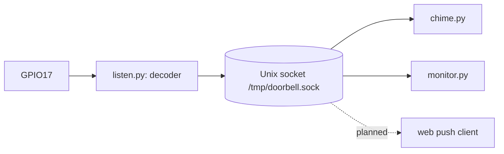

# Event bus: receiver and clients

The receiver only decodes the radio signal and broadcasts events. Each reaction
to a press is a separate client process: the chime, the terminal monitor, and
later a web push client. A client can crash, restart, or be turned off without
an effect on the receiver or on other clients.



## Why a Unix socket

- It needs only the Python standard library. The Pi Zero has no broker to run.
- Only local processes can connect. A client that serves the LAN, for example
  a web push server, reads the socket and controls its own network access.
- Each client gets every event. A slow client does not block the receiver: the
  receiver drops a client that does not read for 0.5 s.

## Protocol

The receiver listens on `DOORBELL_SOCKET` (default `/tmp/doorbell.sock`). It
sends one JSON object per line. Clients send nothing. `time` is Unix time in
seconds.

| Event | Example | When |
| --- | --- | --- |
| `hello` | `{"type": "hello", "pressed": false, "time": 1729700000.0}` | First line after each connect. Gives the current button state. |
| `press` | `{"type": "press", "code": "0xA55A5A", "time": 1729700000.0}` | The first frame after the button was released. |
| `release` | `{"type": "release", "code": "0xA55A5A", "time": 1729700001.2, "duration": 0.7}` | 0.5 s without a frame. `duration` is the time from the first to the last frame. |

The sender transmits while it has power. The hold-up capacitor keeps it on
after the button comes up, so `duration` is a little longer than the real
press.

Write a client with `events.subscribe()`. It reconnects when the receiver
restarts. Reset the client state on `hello`: a `release` can get lost while
the client is disconnected.

```python
from events import subscribe

for event in subscribe():
    print(event)
```

Debug without Python: `socat - UNIX-CONNECT:/tmp/doorbell.sock`.

Test a client without the radio: stop `doorbell`, then run `simulate.py`. It
serves the same socket and sends events from typed commands. Only one server
can use the socket: `EventServer` refuses to start while another one is live.

## Chime rules

`chime.py` keeps the press pattern logic in `Series` and `choose_sound()`.
Change these two to add new patterns. The current rules:

1. A press starts a new series when the last release was more than
   `DOORBELL_SERIES_GAP` seconds ago (default 10).
2. The Nth press of a series plays the Nth file of `DOORBELL_SOUNDS` (default
   `chime.wav,melody.wav`). Later presses play the last file.
3. A new press stops the current sound and starts the next one at once. The
   chime does not wait for the end of a pattern, so the first sound has no
   delay.
4. While the button stays pressed, the sound repeats, for at most
   `DOORBELL_MAX_HOLD` seconds (default 30).
